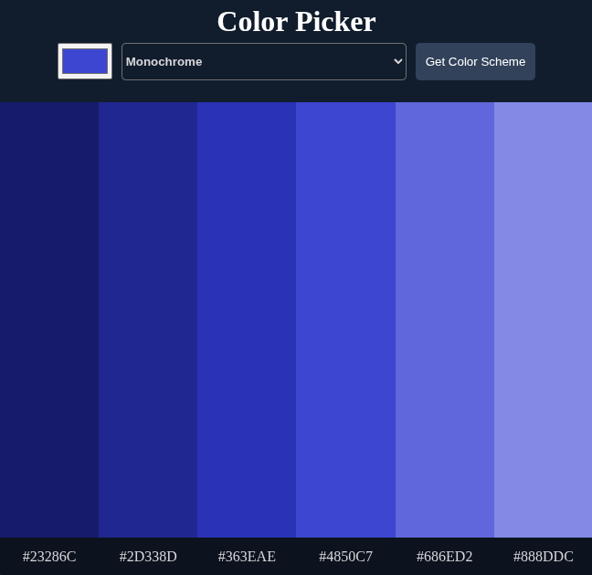

# 🎨 Color Picker

A lightweight web app that generates color schemes using [The Color API](https://www.thecolorapi.com/).

## Features
* Choose any base color with the color picker.
* Select scheme modes (Monochrome, Analogic, Triad, etc.).
* Generates a 6-color palette with hex codes.