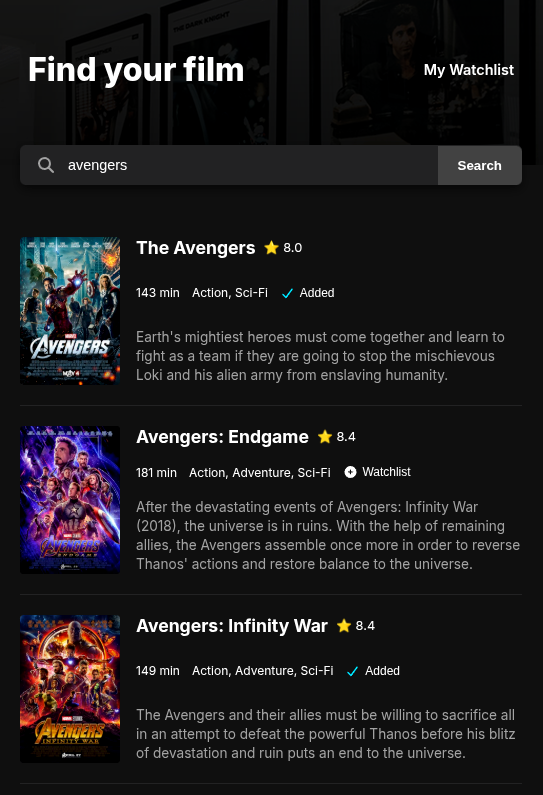
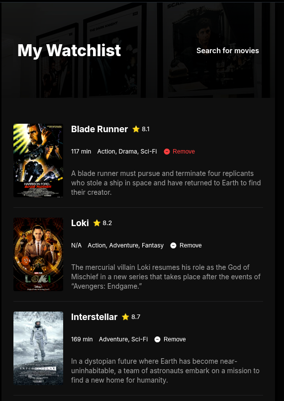

# Movie Watchlist App

A responsive web application built with vanilla JavaScript, HTML5, and CSS3 that lets users search for movies using the OMDb API and save them to a personal watchlist.

## Features

- **Movie Search:** Real-time search powered by the OMDb API.
- **Detailed Info:** View ratings, runtime, genre, poster, and plot summaries.
- **Watchlist Integration:** Add movies to your personal watchlist saved in `localStorage`.
- **Remove Movies:** Manage and remove saved movies from your watchlist anytime.
- **Responsive UI:** Clean, dark-mode design styled using Inter font and FontAwesome icons.

## Screenshot

|                    Homepage                     |                   Watchlist                  |
| :---------------------------------------------: | :----------------------------------------------: |
|  |  |


## Setup & Running Locally

1. **Clone the repository:**
   ```bash
   git clone https://github.com/your-username/movie-watchlist.git
   cd movie-watchlist
   ```

2. **Add your API Key:**
   Edit the `config.js` file in the root directory:
   ```javascript
   export const API_KEY = "https://www.omdbapi.com/?apikey=YOUR_OMDB_API_KEY";
   ```
